# Jamkita

A time bank for neighbours, on BOT Chain.

People who know each other form a *guyub* and trade help. One hour of help is worth one hour, whatever the help is: an hour of Excel lessons pays for an hour of bike repairs. Whoever was helped pays in hours, in one step, or the helper asks and the other side approves.

Hours are not money and not a token. Everyone starts at zero, a balance may go below zero down to the guyub's credit limit, and in every guyub **member balances plus the commons pot always add up to exactly zero**. The contract enforces that; no steward can create hours or change anyone's balance.

*Jamkita* means "our hours". *Guyub* means a close, friendly group.

- Product scope and decisions: [PRD.md](PRD.md)
- Status and what was verified: [PROGRESS.md](PROGRESS.md)
- Network: BOT Chain Mainnet, chain ID 677 — <https://botchain.ai> · <https://scan.botchain.ai>

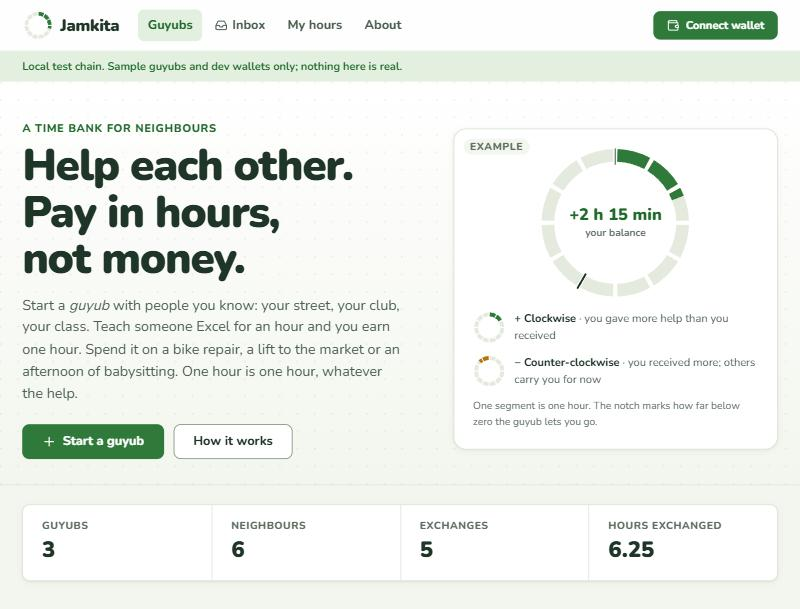

## Screenshots

Taken on the local chain on 11 November 2026, with the seed data and the dev wallets. Names, notes and balances are sample data.

### Starting and running a guyub

| | |
|---|---|
| 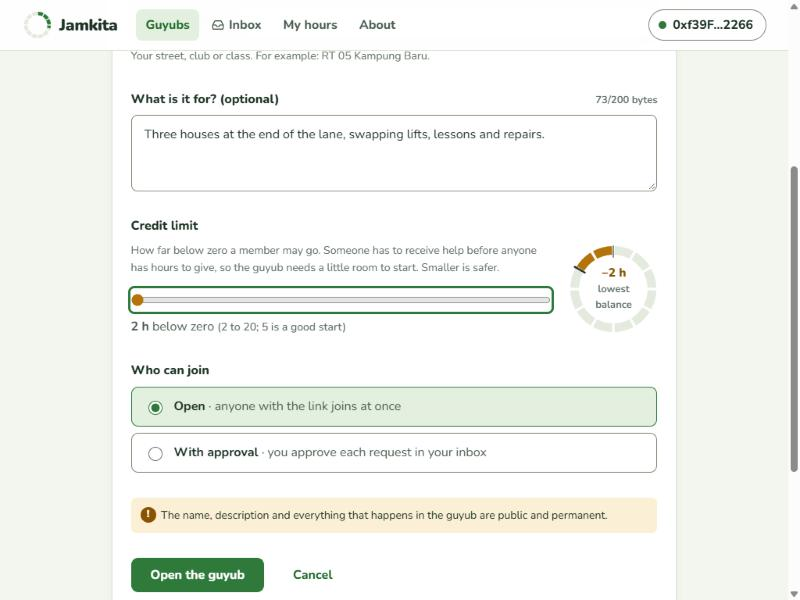 | 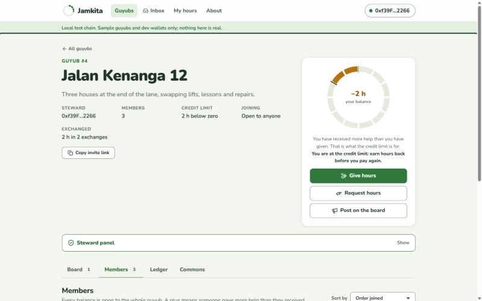 |
| **Start a guyub.** The credit limit slider shows the lowest balance on the ring. | **Guyub page.** Your balance ring, what you can still pay, and the four tabs. |
| 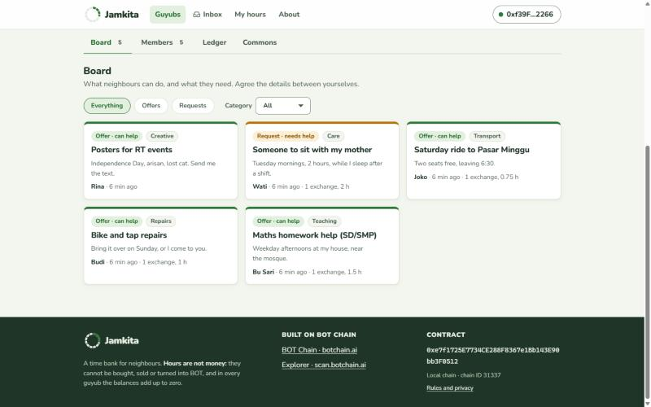 | 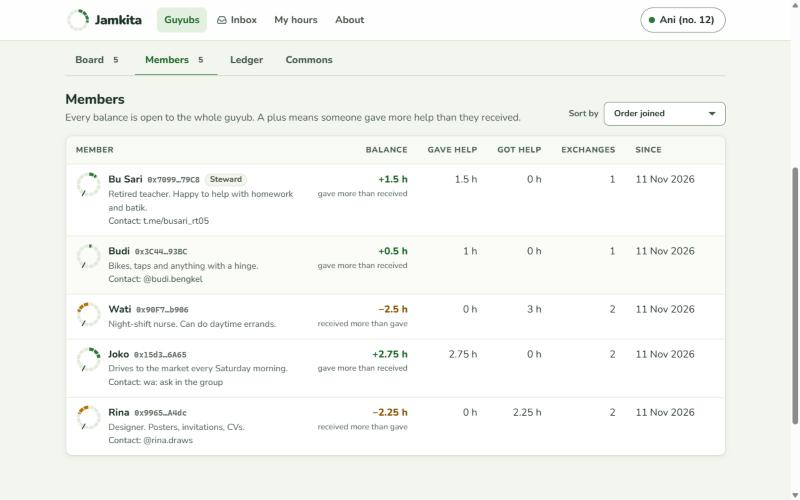 |
| **Board.** Offers (green strip) and requests (turmeric strip), each with a text tag. | **Members.** Every balance is public, with its sign and a plain-words label. |

### Recording help

| | |
|---|---|
| 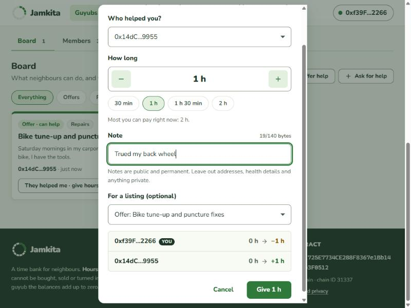 | 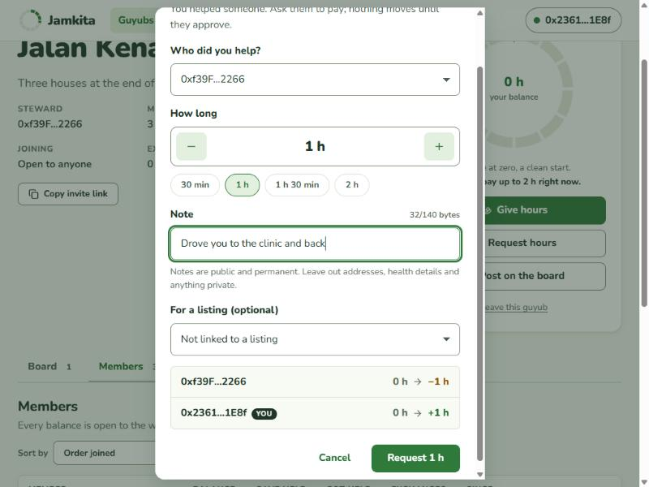 |
| **Give hours.** One step; both balances are shown before and after. | **Request hours.** The helper asks; nothing moves until the other side approves. |
| 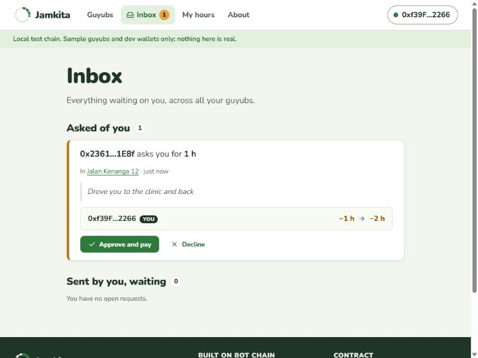 | 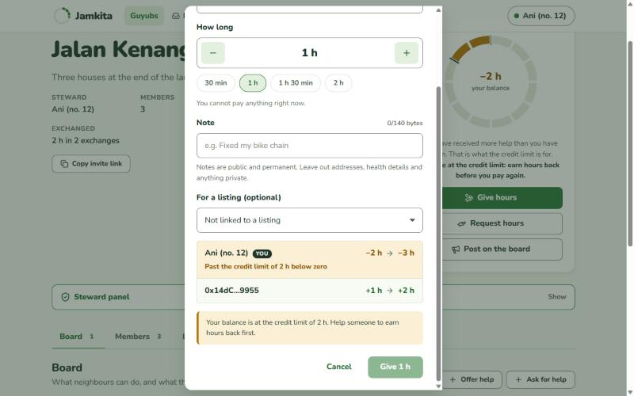 |
| **Inbox.** Everything waiting on you, across all guyubs. | **Credit limit.** A payment past the limit is stopped before it is sent. |

### The ledger and your hours

| | |
|---|---|
| 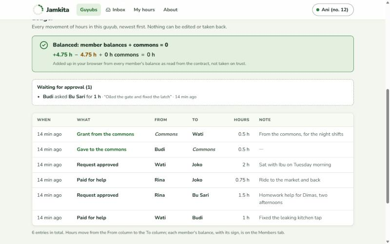 | 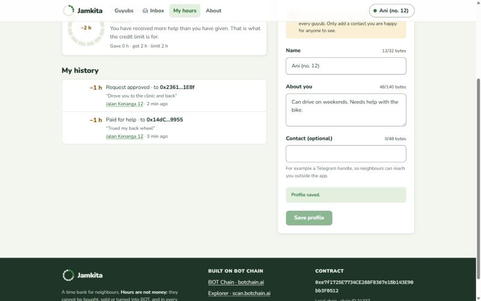 |
| **Ledger.** The zero-sum check is added up in the browser from the contract's data. | **My hours.** Balances, personal history and your public profile. |

### Phone and tablet

| | | |
|---|---|---|
| 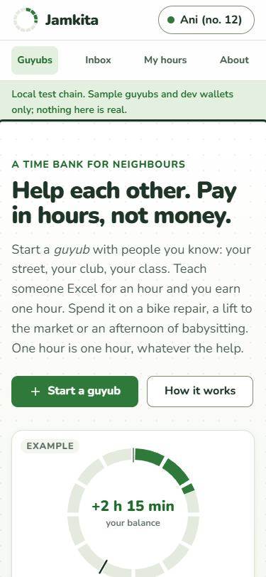 | 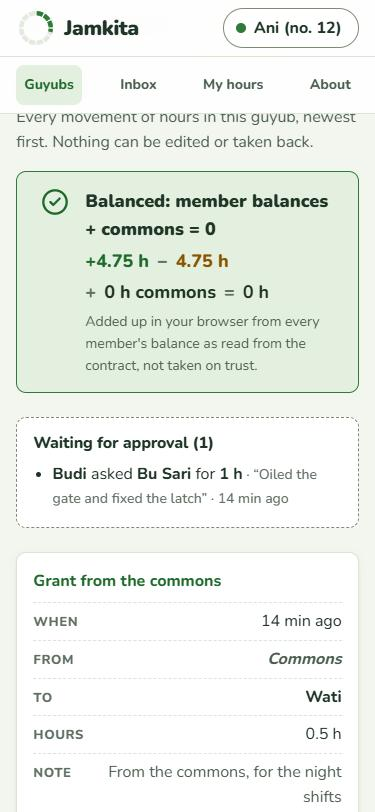 | 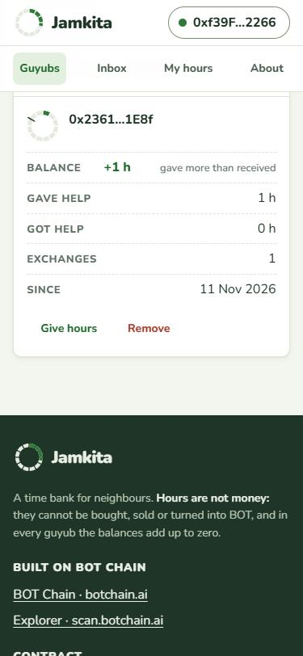 |
| Home, 375 px | Ledger, 375 px | Members, 375 px |

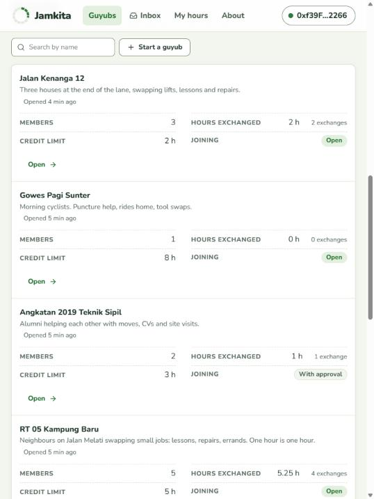

*Guyub directory at 768 px: tables become cards below 900 px, with fields in two columns on tablets.*

## Layout

```
jamkita/
├── contracts/   Hardhat project: Jamkita.sol, tests (incl. the zero-sum invariant test), scripts
├── docs/        Screenshots used in this README
└── web/         Vite + React + TypeScript + viem front end
```

## Run it locally

Requires Node 22. The local chain uses port **8548** and the web app port **5176**, so they can run next to the other projects.

```bash
# 1. A local chain (leave it running)
cd contracts
npm install
npx hardhat node --port 8548
```

```bash
# 2. In a second terminal: deploy, then add sample guyubs
cd contracts
npm run deploy:local
npm run seed:local
```

```bash
# 3. In a third terminal: the web app, at http://localhost:5176
cd web
npm install
npm run dev
```

On the local chain the wallet dialog lists four "Dev wallet" accounts (Ani, Bayu, Cahya, Dimas). They ask the Hardhat node to sign, so you can open a guyub, join it from other wallets and trade hours without a browser extension. The seed script leaves these four accounts untouched. They exist only in the dev server; production builds do not contain them.

## Checks

```bash
cd contracts && npm test          # 44 tests: every rule and rejection, plus the 2,400-action invariant test
cd contracts && npm run size      # deployed bytecode size against the 24 KB limit
cd contracts && npm run gas       # gas of everyday actions
cd web && npm run typecheck       # TypeScript
cd web && npm run build           # production build into web/dist
```

The invariant test can run longer or with another seed: `INVARIANT_ACTIONS=5000 INVARIANT_SEED=42 npm run test:invariant`.

## Which network the web app uses

| `VITE_CHAIN` | Network | Used by default in |
|---|---|---|
| `local` | Hardhat node, chain 31337, port 8548 | `npm run dev` |
| `testnet` | BOT Chain Testnet, chain 968 | — |
| `mainnet` | BOT Chain Mainnet, chain 677 | `npm run build` |

Contract addresses live in `web/src/config/deployments.json`. The deploy script fills in the right entry. Until an address is present for the active network, the site shows a "not deployed yet" notice instead of guyubs.

The public mainnet RPC has `eth_getLogs` disabled, so the app reads everything through the contract's view functions; history is stored in the contract, not only in events.

## Deploy the contract

The deployer key stays on your machine.

```bash
cd contracts
cp .env.example .env      # then put the deployer key in .env as PRIVATE_KEY=0x...
npm run deploy:testnet    # BOT Chain Testnet (968) — test BOT from https://faucet.botchain.ai/basic
npm run deploy:mainnet    # BOT Chain Mainnet (677)
```

Deploying costs about 0.093 BOT at 20 gwei. Each deploy writes `contracts/deployments/<network>.json` and updates `web/src/config/deployments.json`; commit both so the site picks up the address. After a contract change, run `npm run export-abi` so the web app uses the new ABI.

Do not deploy to mainnet before the project's group exists: the program does not count projects that were on mainnet earlier.

## Host the web app on Vercel

| Setting | Value |
|---|---|
| Root Directory | `web` |
| Framework Preset | Vite |
| Build Command | `npm run build` |
| Output Directory | `dist` |

No environment variables are needed for mainnet. Routes are hash-based (`#/guyub/3/ledger`), so no rewrites are required.

## What the contract costs to use

Measured with `npm run gas`, at 20 gwei:

| Action | Gas | BOT |
|---|---|---|
| Deploy | 4,624,780 | 0.0925 |
| Open a guyub | 320,728 | 0.0064 |
| Join (open guyub) | 132,148 | 0.0026 |
| Set a profile | 137,266 | 0.0027 |
| Post an offer | 254,995 | 0.0051 |
| Give hours | 175,912 | 0.0035 |
| Request hours | 324,145 | 0.0065 |
| Approve a request | 125,809 | 0.0025 |
| Give to the commons | 73,909 | 0.0015 |
| Grant from the commons | 114,931 | 0.0023 |

Deployed bytecode: 21,160 bytes, 86.1% of the 24,576-byte limit, so all view functions stay in one contract.

The contract holds no funds, has no owner and has no payable function.
